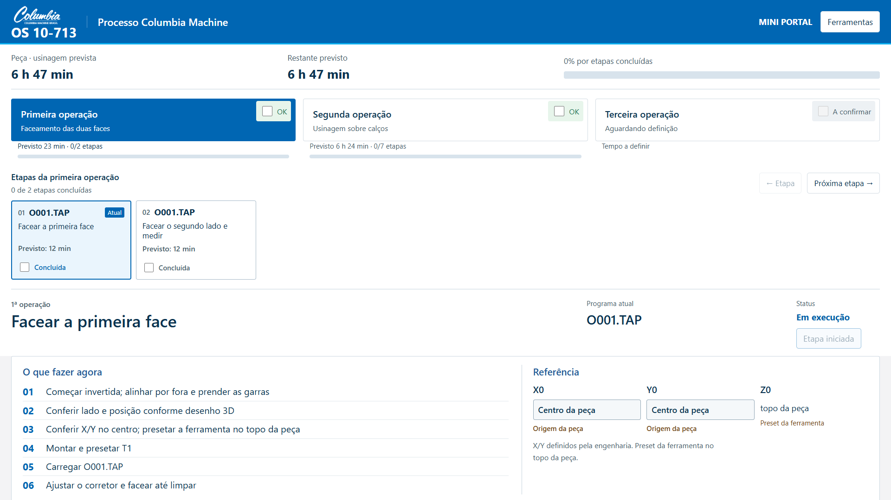
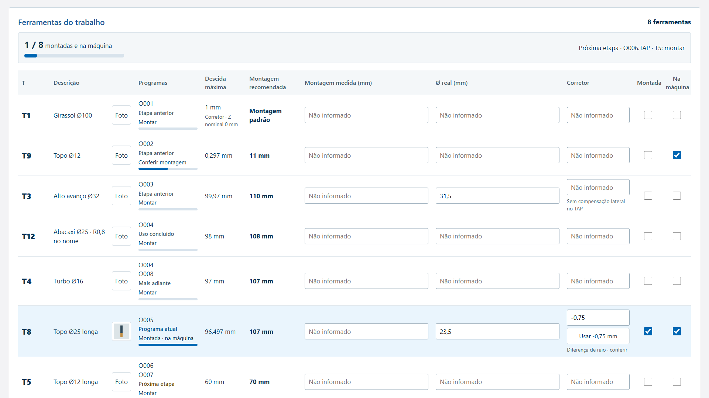

# Entrega de continuidade — 12/10/2026

A versão atual do protótipo foi consolidada neste repositório, com as fontes que geram index.html, build portátil, domínios, parser existente, TAPs originais, testes e instruções para Claude Code.

## Ajustes finais

Retirada a linha explicativa sob a previsão de tempo, preservando os cálculos com +20%. Status corrigido: o início ficou inacessível quando o checklist antigo foi arquivado. Iniciar etapa agora registra Em execução; a caixa Concluída registra Concluída. Desmarcar volta a Não iniciada. A terceira operação mostra A confirmar.

## Validação da versão do repositório

- Cinco suítes de domínio e cinco de navegador passaram, sem erros JavaScript.
- Início manual, persistência, isolamento por etapa, conclusão e reset; Play e navegação não registram produção.
- O001–O008, O004 com duas ferramentas em uma etapa, migração histórica, desenho de cinco páginas e propostas de in-process preservados.
- Tempos com 20%, 24365 segundos planejados, progresso por tempo/conclusão; terceira operação desconhecida.
- Corretor por diferença de raio, campos compartilhados, fotos, falha de armazenamento, uso da próxima etapa e estudo de insertos verificados.
- Sem overflow horizontal em 1920×1080, 1440×900 e 390×844. Altura do 3D: 620/550/390 px; proporção desktop permanece acima de 60%.
- Oito TAPs conferidos por SHA-256. Duas verificações Python adicionais conferem linhas exatas dos originais e a execução do parser em O001/O004.
- O build do repositório reproduz o HTML local. Dados e fotos de testes não foram incorporados à entrega.

[Relatório do status](validacao/Validacao_Status_Local.json) · [Ferramentas](validacao/Validacao_Ferramentas_Andamento_Local.json) · [Tempos/insertos](validacao/Validacao_Progresso_Local.json) · [In-process](validacao/Validacao_Inprocess_Local.json) · [Fluxo completo](validacao/Validacao_Simplificacao_Local.json).

As fotos nas capturas de teste são fixtures sintéticas identificadas; não são fotos reais de ferramental da Columbia.
