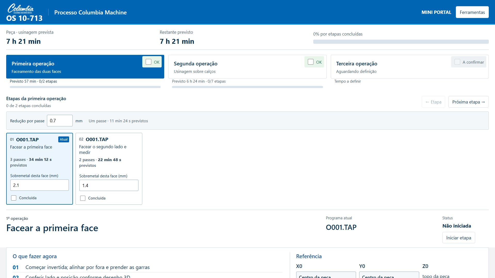
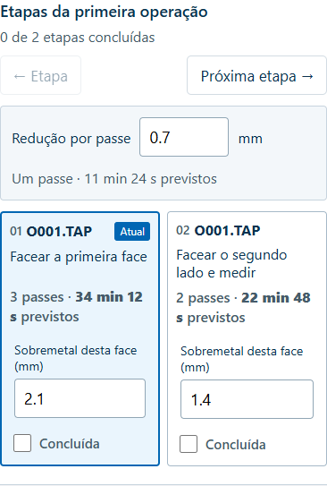

# Previsão de faceamento por sobremetal

O tempo de O001 extraído do arquivo descreve um passe. A previsão anterior atribuía apenas esse passe a cada face, mesmo quando era necessário repetir o programa.

Cada card de face agora permite informar o sobremetal a retirar. A redução padrão de 0,7 mm por passe foi confirmada pelo operador e é editável. A regra de domínio calcula o número inteiro de passes para cobrir a retirada: ceil(sobremetal/redução). A margem de tempo existente de 20% continua aplicada.

Exemplo de validação, não medida real da peça: primeira face 2,1 mm → 3 passes; segunda 1,4 mm → 2 passes. O arquivo indica 9 min 30 s por passe; com 20%, um passe previsto leva 11 min 24 s. As faces ficam em 34 min 12 s e 22 min 48 s; primeira operação 57 min. A peça recebida neste cenário fica em 7 h 21 min (arredondamento do total para minutos).

Sem medida válida de qualquer face, o total de faceamento/peça permanece A definir. O restante fica A definir enquanto houver uma face pendente sem estimativa; uma face já concluída não impede calcular o tempo restante das etapas conhecidas. A segunda operação conserva sua previsão própria. Enquanto o tempo é desconhecido, a barra registra quantidade de etapas concluídas, identificada no texto; com as medidas, volta a ponderar pelo tempo. Os registros de conclusão existentes permanecem intactos. Nenhum valor de teste é pré-carregado e nenhum TAP foi modificado.

Verificações: arredondamento exato em 1,4/0,7 e 2,1/0,7; passe adicional em 1,4001/0,7; valores ausentes, negativos, zero e excessivos; mudança da redução; persistência; medidas independentes por face; conclusão preservada; programa/ferramenta atual; nenhum overflow em 1920×1080, 1440×900 e 390×844; 3D mantém 620/550/390 px.

[Relatório](validacao/Validacao_Faceamento_Local.json)

