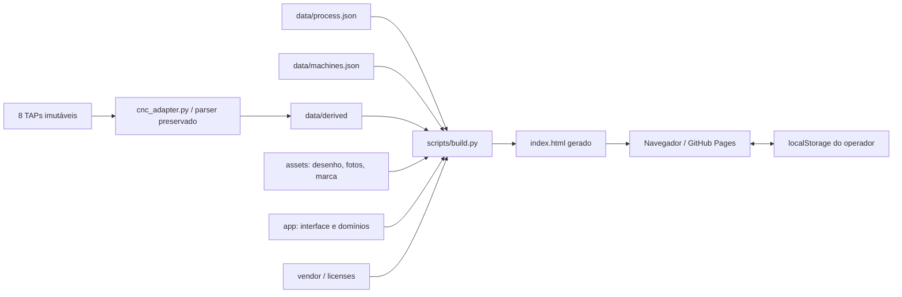

# Arquitetura V1

Frontend estático, sem framework novo. Mantém o renderer Three.js, o componente de percurso gviewer e o snapshot easy_gcode_plot. A separação é por responsabilidade; não há API, banco de dados, login ou operação de múltiplas máquinas.

## Responsabilidades

app/prototype-template.html conserva o shell e a montagem 3D existentes. app/operator_layer.js conecta o processo à navegação, às referências e aos registros manuais. app/storage.js recupera estruturas inválidas de armazenamento sem trocar a chave ou renumerar IDs.

app/tool_length_domain.js avalia descida e montagem; tool_visual_domain.js resolve a representação usando medida/refêrencia; tool_work_domain.js calcula uso/status e sugestão do corretor. app/job_timing_domain.js calcula passes/tempos/progresso; job_timing_ui.js apresenta os resultados. app/ferramental contém o domínio de montagens/fotos e insertos e seus componentes. app/simulation contém integração gviewer e interação Three.

O cadastro data/process.json usa steps para dados industriais e runtime para apresentação/navegação legada. runtime.phases preserva os IDs persistidos; runtime.operations seleciona somente nove etapas ativas. steps 1/3/7 preservam vínculos históricos; não devem aparecer como novos passos. Novas revisões precisam de migração explícita de IDs e registros. Não inferir posição física do magazine a partir de T lógico.

scripts/project_contract.py rejeita ferramentas desconhecidas, programas divergentes, IDs/etapas repetidos ou arquivados ativos, máquina inexistente, calços/espessura divergentes e alteração de originais. scripts/build.py expande os fragmentos internos do template e deixa as bibliotecas de terceiros intactas. Falhas interrompem o build antes de gravar index.html.

## Camada de jornada

app/journey/journey_domain.js (regras puras: objetivos candidatos, sobremetal, progresso, estados dos nós, próxima etapa, passaporte) e app/journey/journey_ui.js (cabeçalho da OS, mapa, recebimento, controles, roteiro de 8 seções, 3D contextual, passaporte, pendências) entram depois do operator layer pelo token __JOURNEY_LAYER__. Envolvem renderOperational, renderOperationNavigation, renderJobTiming e init3d sem alterar seus contratos. Estilos: design/tokens.json → scripts/design_tokens.py → __DS_TOKENS_CSS__; app/design/components.css; app/journey/journey.css (último). Registros novos: state.journey e startedAt/completedAt aditivos em state.operator.

## Fronteiras mantidas

Parser → derivados é uma mudança de engenharia, separada da apresentação. Para regenerar: python scripts/cnc_adapter.py, python scripts/build_strategy_data.py, python scripts/build_cavity_data.py, depois validar parser/linhas/hash e build. Execute da raiz. Relatórios históricos em data/derived/cnc são evidência; não são cadastro editável.

Processo → interface exige build. Estado do operador → localStorage não volta para JSON industrial. Não incorporar fixtures, medições ou fotos de testes ao HTML publicado. O runtime de máquina adicional é histórico e permanece isolado; o piloto não expõe seletor de máquinas.

A evolução futura pode extrair o restante do renderer e reduzir o HTML, com testes de comportamento antes/depois. Essa extração ampla ficou fora do prazo do protótipo para preservar a simulação.
